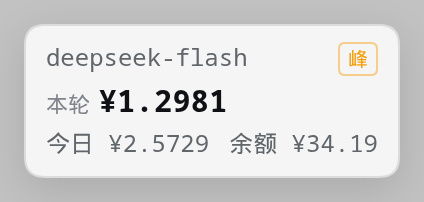
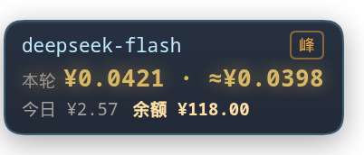
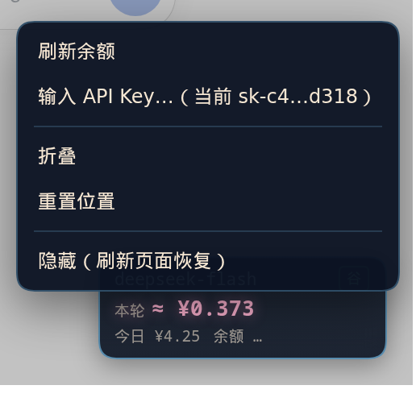

# dsh-billing-chip

[](https://www.npmjs.com/package/dsh-billing-chip)
[](https://www.npmjs.com/package/dsh-billing-chip)
[](LICENSE)

挂在 DSH Web 界面右下角的一小块**纯文字计费牌**：当前模型、这一轮花了多少、今天累计多少、DeepSeek 账户还剩多少、现在是峰时还是谷时。右键可以直接填 API Key。

没有头像、没有插画、没有动画 —— 只有数字。窄到不挡事，一眼能看完。



**特色是「本轮花费实时估算」**：DSH 的会话日志要 1–5 分钟才落盘，等它算钱，一轮早结束了。这个插件直接订阅模型输出流，数着生成的字符实时折算 token，钱在牌子上一分一分往上跳 —— 不用等账。结算后再把「实际 · 预估」并排放在一起，让你知道这次估得准不准。

## 实时估算怎么算（本仓库的重点）

同一套算法移植自桌宠的计费板（`bridge.mjs` 的 `estAdd` / `estEmit`）：

1. 跟随当前活跃会话的 assistant 流，收 `reasoning-delta` / `text-delta` 的每一段文字（思考内容也算，它是要计费的）
2. 字符折算输出 token：**汉字 0.6 token/字，其他字符 0.3 token/字**
3. 输出侧取 `max(本轮已结算 output, 字符估算)` —— 真实值到了就以真实值为准
4. 输入侧用本轮已结算的 `cacheRead` + `uncachedInput`；这一步还没结算时，退回上一次请求的量级（每步都重发全量上下文，量级接近）
5. 套官方价（峰/谷）算出金额，每来一段增量就重算

实测（`deepseek-flash`，让模型写 600 字散文）：流式期间涨到 `≈ ¥0.0126`，结算后实际 `¥0.0126`，**误差 0%**。
多 step 的轮次（中间调工具）按同一个 turn 累加字符，不会被每次工具调用打断。

## 它算的是什么

DSH 每一轮对话都会把 `usage`（输入 / 缓存命中 / 缓存写入 / 输出 token）写进会话日志：

```
$DSH_HOME/sessions/<workspace>/<session-id>/session.v4.jsonl.zstd
```

日志写盘有 **1–5 分钟延迟**，光靠它算不出"正在涨的钱"。所以插件挂了两条腿：

| 数据源 | 拿到什么 | 延迟 |
| --- | --- | --- |
| 会话日志 `session.v4.jsonl.zstd` | 已结算的 usage、模型、turn 边界、今日汇总 | 1–5 分钟 |
| assistant 流（进程内 `sessionController.follow` + `assistantStream`） | 正在生成的思考/正文增量，用来实时估钱 | 立刻 |

两条腿合并成一块牌子：

| 项目 | 说明 |
| --- | --- |
| 本轮 | 跑着的时候用流式预估（粉色 `≈ ¥`，实时在涨）；`turn/end` 一到换成本轮实际花费，预估和实际差 ≥3% 时并排显示 `¥实际 · ≈¥预估` |
| 今日 | 今天所有会话加起来的花费与 token 数（跨 workspace、跨 session 汇总） |
| 余额 | 调 `GET https://api.deepseek.com/user/balance`，显示 CNY 可用余额 |

余额什么时候刷：

- **每轮刚结束时**（日志里出现 `turn/end`）立刻拉一次 —— 刚花掉钱，数字得跟上
- **缓存超过 60 秒**时后台补一次（先显示旧值，拉到后下次轮询自动替换，不会突然变成「…」）
- **保存新 Key 后**、**右键「刷新余额」**时同步拉一次
- 失败不覆盖旧值：网络抖动或 Key 失效时，牌子上继续显示上一次成功的结果

| 峰 / 谷 | 北京时间工作日 09:00–12:00、14:00–18:00 为高峰（价格翻倍）；周末与法定节假日全天按谷时价 |

订阅流走的是 DSH 自己的 `sessionController.follow()`（cordis service，没装就自动退回只读日志），不抓 cookie、不碰私有 HTTP 端点。

## 显示

```
deepseek-flash      峰
本轮 ¥0.0421
今日 ¥2.57  余额 ¥118.00
```

配色和金额刻度与桌宠的计费牌一致：深梦蓝渐变卡、模型名浅蓝 `#bfeaff`、本轮数字暖黄 `#ffe1a8`、次要信息奶油色 62%。

本轮有这几种状态：

| 状态 | 文案 | 颜色 |
| --- | --- | --- |
| 轮次进行中 | `≈ ¥0.0123` | 粉 `#ffb3d1`（实时流式预估） |
| 刚结算，预估和实际差 ≥3% | `¥0.0123 · ≈¥0.0110` | 金 `#ffd873`，闪 2.4 秒 |
| 刚结算，两者接近 | `¥0.0123` | 金 `#ffd873`，闪 2.4 秒 |
| 已结束 | `¥0.0123` | 奶油 `#f6e7d3` |

小数位按桌宠的 `money4` 规则：≥1 两位、≥0.01 三位、更小四位；今日与余额固定两位。

轮次进行中（粉）：


刚结算完（金色，闪 2.4 秒）：



牌子上能做什么：

- **拖动**：按住牌子拖到任意位置（位置记在 localStorage，同时回报给后端）
- **双击**：折叠成一行（只留模型和本轮金额）
- **右键**：菜单



右键菜单里：

- **刷新余额** —— 立刻重新拉一次（平时也会自动刷，见下）
- **输入 API Key…** —— 弹出输入框，保存后马上验证并显示余额；留空保存等于清除
- **折叠 / 展开**
- **重置位置** —— 回到右下角
- **隐藏** —— 只是本地隐藏，刷新页面就回来

还没填 Key 的时候，直接**点一下牌子**也会弹出输入框。

## 让 AI 帮你装

包里带了两个脚本和一份给 AI 的流程说明（[SETUP-AI.md](SETUP-AI.md)），把仓库地址丢给 DSH 里的 AI，它照着做就行：

```bash
# 1. 定位 DSH：环境变量 → 本机监听端口 → 局域网扫描 → 手动填写
node scripts/find-dsh.mjs

# 2. 挂进 profile（先 dry-run 看改动，再 --write 落盘）
node scripts/enable-in-profile.mjs --profile web --write

# 3. 重启 dsh web，验证
curl -s "$DSH_URL/api/dsh-billing-chip/state" -H "Origin: $DSH_URL"
```

`find-dsh.mjs` 认 DSH 的方式是两道指纹：未登录时 HTTP `401` + 正文 `dsh web authentication required; …`，或者登录后首页 HTML 里含 `__DSH_BOOT__`。扫局域网时它会自动跳过 docker / VPN 虚拟网卡，默认端口是 `3080, 3099, 3000, 8080, 8000`，都能用参数改。

| 脚本 | 干什么 |
| --- | --- |
| `scripts/find-dsh.mjs` | 三级探测 DSH 地址：`--local` / `--lan` / `--url` / `--range` / `--ports` / `--manual` / `--json` |
| `scripts/enable-in-profile.mjs` | 改 profile 的 `dependencies` 与 `dsh.profile.bundles` 并跑 `pnpm install`；默认 dry-run，`--write` 才落盘，改前自动备份 |

## 安装

一行（[npm](https://www.npmjs.com/package/dsh-billing-chip) 上的 `dsh-billing-chip@0.2.0`，装进 `web` profile）：

```bash
dsh plugin --profile web add dsh-billing-chip
```

想直接跟 GitHub 上的最新提交：

```bash
dsh plugin --profile web add github:EuphonXD/dsh-billing-chip
```

两种装法都会把包装进 profile 的 `node_modules`，但**都要手动把 `dsh-billing-chip` 加进 profile 的 `dsh.profile.bundles`** 再重启 `dsh web`，细节见下面两节。

### 作为 bundle 装进 profile（推荐）

```bash
# 1. 把包 link 进 profile（dsh plugin 就是把参数转发给 pnpm）
dsh plugin --profile web add link:/path/to/dsh-billing-chip

# 2. 手动把名字加进 profile 的 dsh.profile.bundles —— 这一步 dsh plugin 不会替你做
#    然后 pnpm install / 重启 dsh web
```

profile 的 `package.json` 应该长这样：

```json
{
  "dependencies": {
    "dsh-billing-chip": "link:/path/to/dsh-billing-chip"
  },
  "dsh": {
    "profile": {
      "bundles": ["@deepseek-ai/dsh-base", "@deepseek-ai/dsh-web-app", "dsh-billing-chip"]
    }
  }
}
```

然后 `pnpm install`、重启 `dsh web`。插件自带 `cordis.patch.yml`，bundle 加载时会自动 insert。

### 装进已有 profile 的 patch

不想改 bundles 的话，把这条抄进 profile 的 `cordis.patch.yml`：

```yaml
- insert:
    - id: dsh-billing-chip
      name: 'dsh-billing-chip'
```

## 配置

在 `cordis.yml`（或 profile 的 patch）里给插件传 config，全部可选：

```yaml
- id: dsh-billing-chip
  name: 'dsh-billing-chip'
  config:
    apiKey: ''              # 也可以在这里给 Key（不推荐，会进版本库）
    defaultModel: deepseek-flash   # 日志里读不到模型时的兜底
    settingsPath: ''        # 默认 $DSH_HOME/dsh-billing-chip/settings.json
    allowRemote: false      # true 才允许任意来源（含非浏览器的远程脚本）访问它的 HTTP 路由
    priceOverrides:         # 官方调价时不用改代码
      deepseek-flash:
        hit: [0.02, 0.04]
        miss: [1, 2]
        out: [4, 8]
```

**API Key 的三种来源**（优先级从高到低）：

1. 右键菜单里填的 —— 存在 `$DSH_HOME/dsh-billing-chip/settings.json`，权限 `0600`
2. 插件 config 里的 `apiKey`
3. 环境变量 `DEEPSEEK_API_KEY`

填过之后牌子上会显示余额；鼠标悬停能看到 Key 来自哪一层。

## HTTP 接口（同源，给 client 用）

| 方法 | 路径 | 作用 |
| --- | --- | --- |
| GET | `/api/dsh-billing-chip/state` | 模型、本轮（日志口径 `turn`）、实时预估（`live`）、今日、余额、界面偏好 |
| POST | `/api/dsh-billing-chip/key` | `{ "apiKey": "sk-..." }` 保存并立即验证；空串等于清除 |
| POST | `/api/dsh-billing-chip/refresh` | 重新拉余额 |
| POST | `/api/dsh-billing-chip/ui` | `{ "position": {x,y}, "collapsed": bool }` 记界面偏好 |

`state` 返回示例：

```json
{
  "ok": true,
  "model": "deepseek-flash",
  "provider": "deepseek-official",
  "turn": { "index": 2, "cost": 0.7561, "peak": true, "done": false,
            "usage": { "inputTokens": 117045, "cacheReadTokens": 6781184,
                       "cacheWriteTokens": 0, "outputTokens": 31347,
                       "totalTokens": 6929576 } },
  "live": { "turn": 2, "step": 1, "active": true, "chars": 776.4,
            "estCost": 0.0121, "estTokens": 35624, "estOut": 1062,
            "actualCost": null, "frames": 918, "lastType": "stream:chunk" },
  "today": { "date": "2026-10-26", "cost": 2.03, "tokens": 25371513, "messages": 259 },
  "peak": true,
  "sessions": 5,
  "hasKey": true,
  "keyMasked": "sk-ab…9f21",
  "keySource": "settings",
  "balance": { "currency": "CNY", "total": 118.0, "granted": 0, "toppedUp": 118.0, "available": true },
  "allowRemote": false,
  "ui": {}
}
```

## 隐私与安全

- **只读**：会话日志只读不写；除 `GET /user/balance`（带你的 Key）之外不向任何地方发请求，也没有埋点。
- **Key 只存在本机**：写进 `$DSH_HOME/dsh-billing-chip/settings.json`，`0600`；接口只回显掩码（`sk-ab…9f21`），不返回明文。日志里不打印 Key。
- **默认只接受本机或同源请求**：`allowRemote: false` 时，只有回环地址（127.0.0.1 / ::1）或者 Origin 与 Host 一致的浏览器请求能通过。也就是说，你在局域网里用 `http://192.168.1.10:3080` 打开 DSH，牌子照常工作；但外部脚本直接 `curl` 这个接口会被 403 挡掉。远程运维要直连接口时才把它设成 `true`。
- 顺带一提：这个端口本身有没有登录保护取决于你的 DSH 部署 —— 插件只是不额外扩大暴露面。
- 界面完全由 client half 自绘，配色沿用桌宠牌子的深梦蓝色板（深色卡 + 奶油字 + 暖黄数字），亮色/暗色主题下都是同一块深色小牌。

## 已知限制

- **只认 DeepSeek 官方价**。用别的 provider（openrouter、自建中转等）时，token 数是对的，钱数只是按 DeepSeek 价估算 —— 想准就自己配 `priceOverrides`。
- **是估算，不是账单**。DSH 记录的是模型返回的 usage，官方的实际扣费可能因为缓存判定、四舍五入有细微差别。
- 今日累计扫的是 `$DSH_HOME/sessions` 下所有 workspace 的日志，**子代理的会话也算在里面**（它们的 usage 同样落在日志里）。
- 节假日表写在 `src/index.js` 顶部，每年要补一次。
- 需要 Node ≥ 22.13（用到 `zlib.zstdDecompressSync`）。
- 目前只在 DeepSeek Harness 0.2 的 Web profile 上验证过；`dsh` 是本地起的还是 systemd 起的都行，但**插件必须装在会话所在的那个 dsh 进程的 profile 里** —— 实时流是进程内数据，装在别的实例上只能读到日志（预估会退回"只按已结算 usage 算"）。
- 实时估算靠的是字符折算，**长英文/代码块会比中文更准**（0.3 系数对英文单词偏高一点），极端长的单轮会有百分级偏差。

## License

MIT
